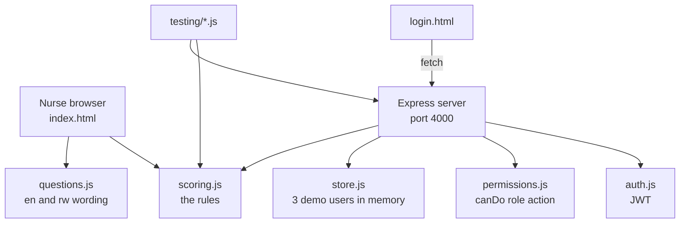
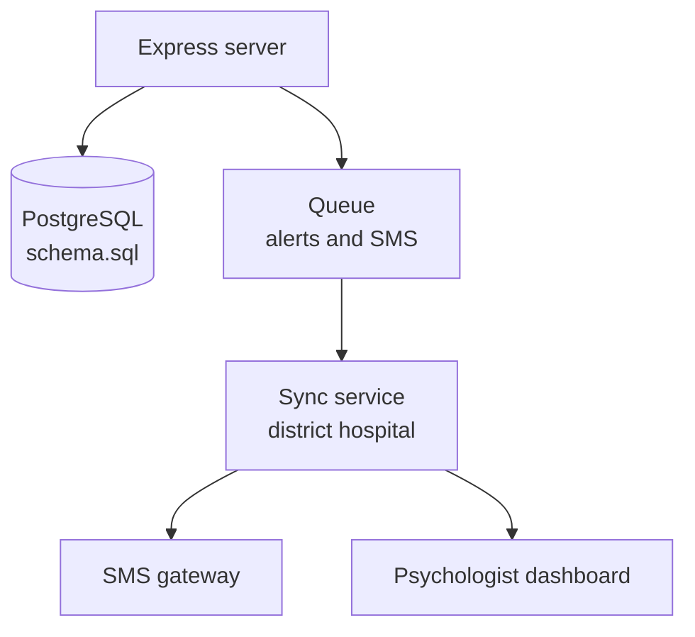

# Architecture

Owner: Djibril. Draft for the Sprint 1 slide.

## What exists in Sprint 1

The screening page runs on its own. Double-click `index.html` and it works with no server, because the browser loads `scoring.js` straight from the backend folder. That is the point of keeping one rules file.

## What Sprint 2 adds

## Choices and why

| Choice | Why |
|---|---|
| One scoring file used by the page, the server and the tests | The rules can never drift apart. |
| Plain JavaScript, no build step | Every line is readable and runs on any laptop with Node. |
| Users in memory this week | Nobody has to install PostgreSQL before the demo. The schema is still written and reviewed. |
| JWT for login | Stateless, so the server keeps no sessions. |
| Permission table in its own file, owned by Ines | The server asks it a question; it never decides roles itself. |
