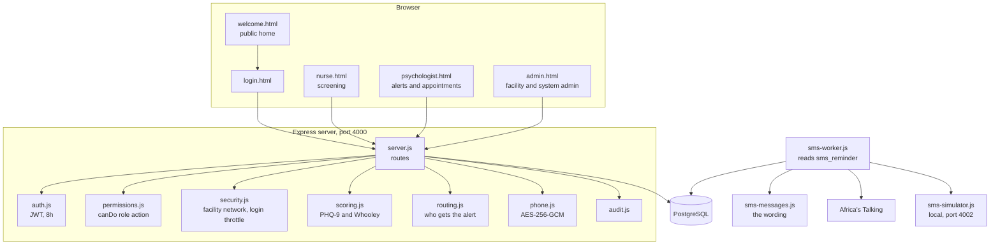

# Architecture

## The whole system

`server.js` starts `sms-worker.js` as a child process, so one `npm start` runs
the whole application.

## Where the rules live

One file owns each rule, and nothing else is allowed to restate it.

| Rule | File |
|---|---|
| PHQ-9 and Whooley scoring | `backend/scoring.js` |
| Severity bands, alert thresholds, who receives an alert, even spread | `backend/routing.js` |
| What each role may do | `backend/permissions.js` |
| Rwanda mobile format and phone encryption | `backend/phone.js` |
| The text of every SMS | `backend/sms-messages.js` |
| Every colour, radius and spacing value in the UI | `frontend/css/style.css`, section 01 |

`backend/scoring.js` is served to the browser at `/backend/scoring.js`, so the
nurse's screen and the server score with the same code and can never drift.

## Choices and why

| Choice | Why |
|---|---|
| One scoring file used by the page, the server and the tests | The rules cannot drift apart. |
| Plain JavaScript, no build step | Every line is readable and runs on any laptop with Node 18+. |
| JWT for sign-in | The server keeps no sessions. |
| Permissions in their own file | The server asks it a question; it never decides roles itself. |
| Patients stored by code, never by name | A leaked record identifies nobody. |
| Phone numbers encrypted with AES-256-GCM | Authenticated, so a tampered record fails to decrypt rather than returning a wrong number. |
| The server binds behind a facility-network check | The application is not reachable from the public internet. |
| SMS wording in one file, separate from the worker | Clinical and language review does not require reading delivery code. |
| Design tokens in one `:root` block | Dark mode is a token swap, not a second stylesheet. |

## Request path for one screening

1. The nurse registers a patient. The server generates `P001`-style code; no
   name is ever sent.
2. Consent is recorded against the patient code.
3. Answers save after every question to `screening_draft`, so a visit can be
   resumed if the nurse is interrupted.
4. `POST /score` scores the answers, writes `screening`, and asks
   `routing.routeAlert()` whether an alert is needed.
5. If it is, the alert is assigned to the psychiatric nurse at that facility
   carrying the fewest open alerts, inside a transaction holding the facility
   row lock so two concurrent screenings cannot pick the same person.
6. The specialist books an appointment. Three rows go into `sms_reminder`:
   patient confirmation now, patient reminder the day before, staff reminder
   the day before.
7. `sms-worker.js` claims rows with `FOR UPDATE SKIP LOCKED`, builds the text
   from `sms-messages.js`, and sends through the configured provider.
